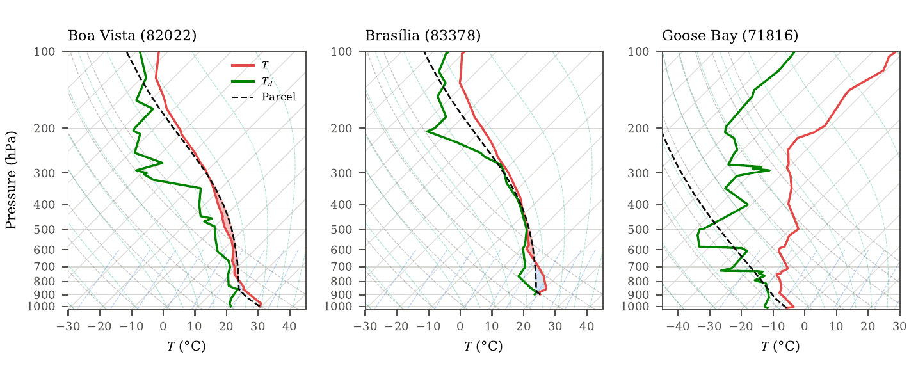
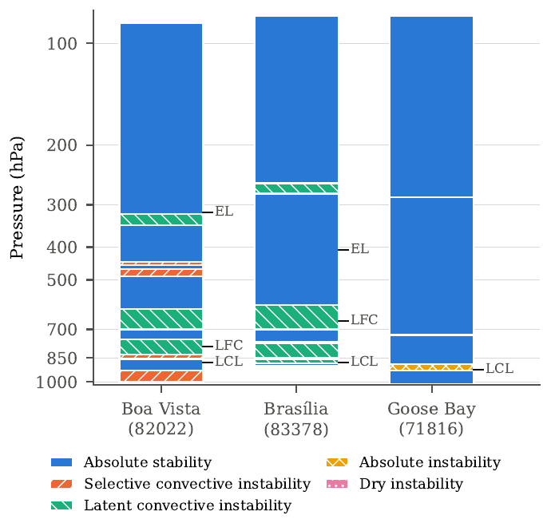

# Stability / Instability Criteria — Radiosonde Profiles

Python tools to analyse the vertical stability of the atmosphere from
radiosonde soundings (University of Wyoming text format): adiabatic and
pseudo-adiabatic (moist) parcel ascent, Skew-T diagrams, and stability indices
(LCL, LFC, EL, CAPE, CIN, precipitable water).

Project 1MET — EHTP, May 2024. Supervisor: Dr. Driss BARI.

## Contents

| Path | Description |
|---|---|
| `src/sounding.py` | Sounding loader (13- and 11-column UWyo files) + MetPy indices and Skew-T plot |
| `notebooks/01_sounding_analysis.ipynb` | Full analysis: adiabatic / pseudo-adiabatic transformations, Skew-T, layer-by-layer stability |
| `data/raw/` | Example soundings `<station>_<place>_<date>_00Z.txt` |
| `data/SOURCES.md` | Links to the UWyo data and column documentation |

Example soundings:

| File | Station | Date |
|---|---|---|
| `71043_norman-wells_2024-01-01_00Z.txt` | 71043 YVQ Norman Wells (Canada) | 2024-01-01 00Z |
| `82022_boa-vista_2023-01-01_00Z.txt` | 82022 SBBV Boa Vista (Brazil) | 2023-01-01 00Z |
| `71816_goose-bay_2024-03-24_00Z.txt` | 71816 YYR Goose Bay (Canada) | 2024-03-24 00Z |
| `83378_brasilia_2024-03-24_00Z.txt` | 83378 SBBR Brasilia (Brazil) | 2024-03-24 00Z |

## Installation

```bash
git clone git@github.com:msaadi15/Stability-Instability-Criteria-Radiosonde-Profiles.git
cd Stability-Instability-Criteria-Radiosonde-Profiles

# pip
pip install -r requirements.txt
# or conda
conda create -n meteo -c conda-forge python=3.11 metpy pandas matplotlib jupyterlab
conda activate meteo
```

## Quick start

Print a summary and the stability indices of a sounding:

```bash
python src/sounding.py data/raw/83378_brasilia_2024-03-24_00Z.txt
```

```
83378 SBBR Brasilia (Aeroporto) Observations at 00Z 24 Mar 2024
69 levels, 898..46 hPa, top 21163 m
...
LCL: 875.6 hPa, 18.3 °C
LFC: 661.1 hPa, 7.9 °C
EL: 408.6 hPa, -12.8 °C
CAPE: 134.4 J / kg
CIN: -133.1 J / kg
PW: 44.2 mm
```

Full analysis in the notebook:

```bash
jupyter lab notebooks/01_sounding_analysis.ipynb
```

## Using it on your own data

### 1. Download a sounding

1. Go to <https://weather.uwyo.edu/upperair/sounding.html>.
2. Choose the region, the station, the date and the hour (00Z / 12Z), and
   select the **Text: List** output.
3. Copy the page into a text file in `data/raw/`, ideally named
   `<station>_<place>_<YYYY-MM-DD>_<HH>Z.txt`
   (e.g. `60155_casablanca_2024-05-01_00Z.txt`).

The loader is tolerant: it keeps only the numeric data rows, takes the first
text line as the title (station / date), and ignores the column headers and the
station-indices block. Both the 13-column format (with `FRPT`, `RELI`) and the
older 11-column format are detected automatically; empty cells become `NaN`.

### 2. Analyse it from Python

```python
import sys; sys.path.insert(0, "src")
from sounding import load_sounding, profile, indices, skewt

df, title = load_sounding("data/raw/60155_casablanca_2024-05-01_00Z.txt")
print(title)
print(df.head())          # PRES HGHT TEMP DWPT FRPT RELH RELI MIXR DRCT SKNT THTA THTE THTV

p, T, Td = profile(df)    # pint quantities ready for metpy.calc
print(indices(df))        # {'LCL': ..., 'LFC': ..., 'EL': ..., 'CAPE': ..., 'CIN': ..., 'PW': ...}

skewt(df, title=title, path="skewt_casablanca.png")   # Skew-T with parcel path + CAPE/CIN shading
```

| Function | Returns |
|---|---|
| `load_sounding(path)` | `(DataFrame, title)` — levels sorted by decreasing pressure, columns as in the [UWyo docs](https://weather.uwyo.edu/upperair/columns.html) |
| `profile(df)` | `(p, T, Td)` as MetPy unit arrays (rows with missing `PRES`/`TEMP`/`DWPT` dropped) |
| `indices(df)` | dict of surface-based parcel indices: LCL, LFC, EL, CAPE, CIN, PW |
| `skewt(df, title, path)` | MetPy `SkewT` object; saves the figure if `path` is given |

### 3. Use the notebook

In `notebooks/01_sounding_analysis.ipynb`, change the path in the
`pd.read_csv('../data/raw/...txt', ...)` cell to your sounding and run all cells
to get the adiabatic / pseudo-adiabatic curves, the Skew-T diagram and the
layer-by-layer stability diagnosis.

The notebook reads the file with `sep='\s+'` and `skiprows=1`, so it expects a
title line followed by complete data rows only. If your sounding has empty
cells or an 11-column layout, load it with `load_sounding` instead:
`df, _ = load_sounding(path)`.

## Stability criteria (reminder)

For a layer with environmental lapse rate γ = −∂T/∂z, compared with the dry
(Γd ≈ 9.8 K/km) and saturated (Γs) adiabatic lapse rates:

| Condition | Layer |
|---|---|
| γ < Γs | absolutely stable |
| Γs < γ < Γd | conditionally unstable |
| γ > Γd | absolutely unstable |

A positive CAPE with a reachable LFC indicates latent (convective) instability;
a large CIN means the parcel needs strong forcing to reach its LFC.

## Results

### Example profiles (Skew-T)

Temperature (red), dew point (green) and surface-based parcel path (dashed)
for three of the example soundings. Shaded areas are CAPE (red) and CIN (blue).



### Layer-by-layer classification

Each layer between two consecutive levels is classified from the environmental
lapse rate compared with the dry and saturated adiabatic lapse rates. The
column below shows the result for each station, with the LCL, LFC and EL marked.



| Station | Profile | Classification |
|---|---|---|
| Boa Vista (82022) | Warm, moist tropical column; CAPE present | Alternating selective and latent convective instability between 1000 and 319 hPa; absolutely stable above |
| Brasília (83378) | Moist low levels, capped by CIN (−133 J/kg), CAPE 134 J/kg | Latent convective instability at 880–768 hPa and 700–593 hPa; absolutely stable elsewhere |
| Goose Bay (71816) | Cold, dry winter profile; no CAPE | Mostly absolutely stable; thin absolutely unstable layer at 925–886 hPa and a negligible dry-unstable layer near 285 hPa |

Classes used: absolute stability, selective convective instability, latent
(conditional) convective instability, absolute instability and dry instability.

## Data source

Soundings from the University of Wyoming, Department of Atmospheric Science —
<https://weather.uwyo.edu/upperair/sounding.shtml>.
